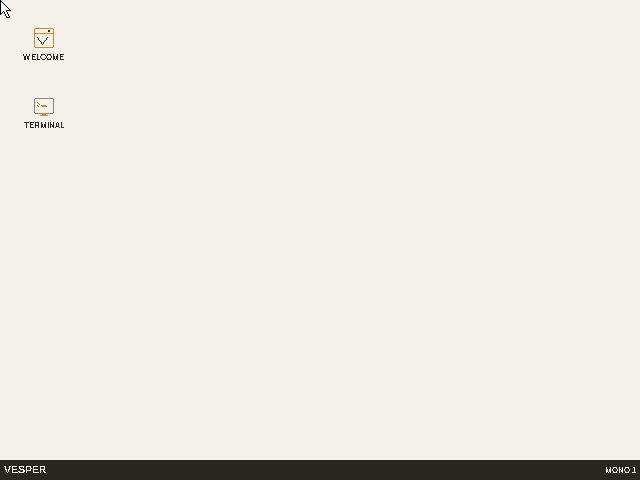
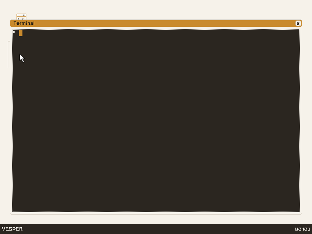
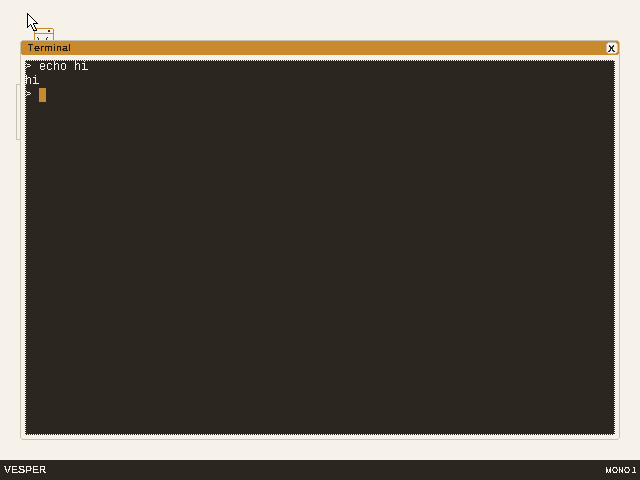

# armv7 的 glibc、busybox、画面与桌面车站

状态：盘上程序能接力 exec 到静态链接的 glibc 程序，程序用 malloc、printf、
open/read 跑完，再 exec 到静态链接的 busybox，busybox 的 echo 打出
`armv7 busybox ok` 后退出 0（2026-11-14 夜）。这份记这一站怎么搭起来的、路上修掉
的几个真问题、以及现在还缺什么。

## 现在的样子

开机 → 客人程序走完自检 → exec `/disk/prog`（盘上 freestanding 程序）→ 它
自己再 exec `/disk/glibc`（静态链接的 glibc 程序）→ 该程序打印两行、退出 0。

判定字面量两条：

- `[glibc] hello from ext2, real libc ran`
- `[glibc] malloc, printf, open all ok`

产物是可选件：没有交叉工具链的机器上不铸 `/glibc`，判定字面量也不加，
车道保持绿色。

## 工具链

`scripts/build-armv7-glibc-prog.sh`，按这个顺序找编译器：

1. `CINUX_ARM_CROSS` 指向的 `arm-*-linux-gnueabihf-gcc`
2. PATH 上的 `arm-none-linux-gnueabihf-gcc` 或 `arm-linux-gnueabihf-gcc`
3. `~/.local/opt/arm-cross/usr/bin/arm-linux-gnueabihf-gcc`（Debian/Ubuntu
   的交叉包解包出来的树，binutils 自带的库在 `usr/lib/x86_64-linux-gnu`）

编译参数：`-mcpu=cortex-a7 -marm -mfpu=neon-vfpv4 -mfloat-abi=hard -static
-no-pie -fno-pie -Wl,-Ttext-segment=0x40010000`。最后那个 `-Ttext-segment`
不是随手写的：armv7 的用户窗口从 0x40000000 起，glibc 默认链在 0x10000，
落在内核 identity 映射里，装载器没法在上面建页表。

## 路上修掉的真问题

**取指中止的 lr 少减一个常数。** `_vec3` 存的是硬件给的 lr，那是故障地址
加四。缺页补好之后从 `pc+4` 恢复，函数头被整条跳过，寄存器留着上一个调用
者的值。glibc 静态启动时那次“目的地址是代码页、长度是地址”的 memset 就是
这么来的——反汇编怎么对都对不上号，因为执行的根本不是那里。

**座的缓存世界会过期。** `SeatRepairPage` 原来用座启动时缓存的 space 与
vmas。exec 一换这两个世界，指针就指向旧的，新程序第一条指令的缺页找不到
自己的段。改成每次故障从当前任务现取。

**IFSR 没有写标记。** 取指故障的状态字第 11 位不是 DFSR 的那个写位，照
DSFR 解码会把每次取指都读成写故障，于是只读代码页拒绝补页。

**用户窗口先是 1MiB，后来越界。** 起初 `IsUserSlot` 只认
`0x40000000>>20` 这一个槽，brk 一过 0x40080000 就撞墙。现在窗口是
`[0x40000000, 0x80000000)`：程序与 brk 在低处，mmap 在中间，入口栈在窗口
顶，`kUserTop` 正好落在内核 identity 映射脚下。中途划到 0x90000000 试过，
那条线把内核自己的 0x80000000 代码也划进用户槽，切根就把内核清了。

**libc 起步缺的三道门。** `set_tls`（ARM 私有号 0x0F0005，替 EL0 写
TPIDRURO，EL0 只能读）、`set_tid_address`、`set_robust_list` 与 `rseq`。
另外 `AT_RANDOM` 不能缺席：硬件取不到时退回种子池，否则 glibc 拿着空的
`_dl_random` 去解引用。

**iovec 的宽度归 ABI。** 中立 `HandleWritev` 原来按 x86 的 16 字节项读，
arm 的项是 8 字节，第一次 writev 吐出来的是二进制里的字符串表。现在两套
`abi.hpp` 各自报出向量字节数与字段位置。

**openat。** 现代 glibc 的 `open` 走 322 号 openat，dirfd 是 AT_FDCWD(-100)。
适配器把它折到中立的 open 面；注意那个哨兵是 32 位字，零扩展成 64 位之后
直接和 -100 比会失败。

**mprotect 的中立化。** 中立处理器原来直接用 x86 的条目位。现在两边各自
提供同一组概念：是否映射、是否大页、叶子指向哪一帧、共享与否。x86 用条目
里的 COW 位说共享，armv7 用帧引用计数说共享。顺带修掉 arm 的只读位：
`UserLeafTerms(writable=false)` 以前不写只读位，叶子照样可写。

**退出路径的根。** 清 `clear_child_tid` 那个字时，退出路径可能已经停在根
上，用户名址在根下没有意义。用户内存门现在在拷贝前借出任务自己的页表，拷
完换回来（记录进来时的根，不要硬编码根）。

## busybox 这一站

`scripts/build-armv7-busybox.sh` 用同一份 busybox 源码与配置交叉编译，
在 `.config` 里把 `CONFIG_EXTRA_LDFLAGS` 定成
`-no-pie -Wl,-Ttext-segment=0x40010000`：默认的 0x10000 落在内核恒等映射
里，装载器没地方放它。strip 要用交叉工具链那一份，宿主的 strip 读不懂 ARM
对象。

产物在 `build/armv7-busybox/busybox`，镜像脚本发现它就铸成 `/bb`；判定字面
量 `armv7 busybox ok` 只在产物存在时加入。调用约定按 busybox 的规矩：
`argv[0]` 得是 `busybox`，applet 名放 `argv[1]`。

## 元数据这一面

`ls`、`stat` 这类 applet 撞上的是一整条元数据街，这一版补齐了三处：

- **statx（397）**：记录是跨架构固定的 256 字节，所以写成一份中立实现，
  两边共用。`AT_EMPTY_PATH`（`flags` 里的 0x1000，第三个参数）表示
  “看这个描述符自己”，是 libc 把 fstat 折到 statx 的用法；空路径要在
  折叠之前判掉，因为路径折叠把空串当非法路径拒绝。
- **fstatat64（327）/ fcntl64（221）**：EABI 的拼法各有各的号，接到中立面
  即可。
- **stat 记录按 ABI 写**：`arch::abi::kStatLayout` 描述字段偏移与宽度，
  x86-64 是 144 字节八字节字段，EABI 是 96 字节混合宽度（64 位 size 在
  第 44 字节，未对齐）。中立层按布局逐字段写，客人自检里的 stat 结构也
  跟着改成了 EABI 那份，并且要 `packed`，否则编译器会把 size 对齐到 48。

现在的终幕是盘上 glibc 程序 exec `busybox stat /disk/prog`，判定字面量
`File: /disk/prog`。

## 画面这一面

LCDIF 在 bring-up 时就往自己的帧里画了一张测试卡：绿色场加一条十六行的高亮条，
外加一个标记字 `0xABCD1234` 放在第 200 行第 5 列。QEMU 抓下来的画面（`screendump`）
里能看到它——蓝条加绿场，左下那个孤零零的红点就是标记：


盘上的 glibc 程序接着走用户侧：`open("/dev/fb0")`、`mmap` 307200 字节（75 个
4 KiB 页），先读第 200 行第 5 列——读到 `ABCD1234`，说明这个映射就是面板本身的
内存，不是私有副本；然后整屏填色、再读回自己写的值。判定字面量
`[glibc] fb seed ABCD1234`。

帧的归属跟着修正了一处：面板的帧属于硬件，不属于分配器。x86 的
`ReleaseFrame` 早就有 `IsHardwarePage` 这一道，armv7 原来没有，于是同一帧被
映射两次时拆卸会还两次、触发 PMM 双重释放。

## 桌面这一站

同一份 `third_party/vesper` 交叉编译到了 armv7，两个车道跑一个桌面而不是两个。

工具链是 Ubuntu 的 armhf GCC 14 交叉包，解包在 `~/.local/opt/arm-cross14`：桌面源码
用了 C++23 的 `<print>`，GCC 14 才有。`cmake/toolchains/armv7-linux-gnueabihf.cmake`
把编译器、sysroot 与 EABI 参数一起交给 CMake，`scripts/build-armv7-vesper-desk.sh`
出一份 1.7MB 的静态 ELF，链在用户窗口内。

跑起来这一路修了两处 ABI 错位，都是“x86 形状搬到 32 位”的老毛病：

- `fb_fix_screeninfo` 里 `unsigned long` 在两边宽度不同：x86-64 八十字节、EABI
  六十四字节。中立 ioctl 原来按 x86 的八十字节回写，把调用者紧挨着的记录抹了
  十六字节——桌面的 `vinfo` 前三个字被清零，于是它看到 0x0 的屏。
  现在 `arch::abi::kFbFixLayout` 描述字段位置，span 宽度也按它取。
- 面板从 320x240 改成 640x480：桌面要求至少 640x480。

跑起来的样子：

```
vesper-fbdev: fb 640x480 (frame 640x480), kbd /dev/event0, pointer /dev/event1
vesper-fbdev: cannot spawn /bin/sh under a pty: Function not implemented
```

第二行是还缺的那块：桌面自带的终端要 `posix_openpt`/`posix_spawn` 那一族。

演示模式：`CINUX_ARM_PROBE_DESK=1 ./scripts/build-armv7-glibc-prog.sh` 让盘上的
glibc 程序最后 exec 桌面而不是 busybox；默认构建仍走可判定的那条链。

## 画面确实画上去了

先前几次 `screendump` 只看到内核测试卡，一度怀疑用户态的写入没落到面板。真相在串口
重定向：`-serial file:` 时输入不再是 UART 的通道，客人卡在读一行上，根本没画到那
一步。改回 `-serial stdio` 并把输出 tee 到文件，画面就出来了——整屏 0x102030 加两
个证明像素：


QEMU 的 LCDIF 每帧重读内存，不需要任何重新触发，所以内核侧不用加刷新钩子。

## 桌面画出来的第一帧

演示模式起 vesper，它开出 640x480 的面板、键盘、指针，然后画出自己的面板栏（底部
那条黑条纹），随即因为“起不了终端”退出：


## 桌面完整跑起来了

挡在终端子进程前面的是 `clone`（EABI 120）：glibc 的 `fork()` 不是老的 fork
系统调用，而是 `clone(SIGCHLD|CLONE_CHILD_SETTID|CLONE_CHILD_CLEARTID, 0, 0, 0, tls)`。
这道门现在接住了“fork 形状”的 clone：低字节有信号位、没有 `CLONE_VM`、没有栈；
共享地址空间的线程形状明确拒绝，不半服务。

接上之后桌面进入自己的循环：

```
vesper-fbdev: fb 640x480 (frame 640x480), kbd /dev/event0, pointer /dev/event1
vesper-fbdev: running; /init's timeout or Ctrl-C ends the run
```

屏幕上于是有了一整个桌面——奶白底、两个图标（WELCOME 与 TERMINAL）、底部面板栏
左边写着 VESPER 右边写着 MONO 1，左上角是鼠标指针：



复跑：`scripts/check-armv7-desk.sh`。它单独铸一张桌面镜像、跑一次、按串口日志判
三条字面量（面板开了、键盘坐上了、进循环了）。默认的 `check-armv7.sh` 仍走可判定
的 busybox 链，两者互不影响。

## 终端子进程走到哪一步

桌面起 shell 的路是这样：`forkpty` → `clone` → `setsid` → `dup2` → `execve`。
这一串补齐了下面这些号，子进程才真的起来：

| 号 | 名字 | 接法 |
| --- | --- | --- |
| 37 | kill | 中立 kill 面 |
| 63 | dup2 | 中立 dup2 面 |
| 65 | getpgrp | 中立进程组面 |
| 66 | setsid | 中立进程组面 |
| 120 | clone | 只接 fork 形状（无 CLONE_VM、无栈） |
| 168 / 336 | poll / ppoll | 中立 poll 面，带 pipe 与 eventfd 后端 |
| 263 / 403 | clock_gettime / clock_gettime64 | 32 位 timespec 的适配器与 64 位中立面 |
| 57 / 132 / 147 | setpgid / getpgid / getsid | 中立进程组面 |

另外，客人根里没有 `/bin`，而桌面按 POSIX 习惯起 `/bin/sh`：盘上的 busybox 现在
在挂载后抄一份到内存根的 `/bin/sh`（1.5MB），于是一个程序期望的位置上真的有 shell。

信号记录也按 ABI 描述了：`arch::abi::kSigActionLayout` 说清 handler、flags、
restorer、mask 各在哪个偏移、多宽。EABI 的 `struct sigaction` 是 20 字节、mask 在
第 12 字节；x86-64 的是 32 字节、mask 在第 24 字节。中立面按这份描述逐字段读写，
`rt_sigaction`(174)、`rt_sigprocmask`(175)、`rt_sigreturn`(173) 一起接上。

同一批还接了 shell 首屏要的 `uname`(122)、`getcwd`(183) 与四个 32 位身份号
（199/200/213/214）。

## 线程指针必须跟着任务走

上一轮留下的“写到别人堆里”的故障这一轮查清了。故障现场反汇编出来是 glibc 的
`str r1, [r2, r3]`——写 **errno**，其中 r2 来自 `mrc p15, 0, r2, c13, c0, 3`，
也就是 TPIDRURO（线程指针）。桌面的 TP 正好落在 shell 的堆里：shell 调
`set_tls` 把寄存器改了，而 TPIDRURO 是**每 CPU 一个**，我们的上下文切换没保存
它，于是桌面的下一次 errno 写入就写进了陌生人的堆。

修法分三层：

- `CpuContext` 加一个 `tpidruro` 槽（偏移 64），切换的两条汇编路径在保存/恢复
  时一起搬它
- fork 的子进程继承父进程的线程指针：子上下文是新造的，TP 从当前寄存器读一份
  放进镜像，否则子进程第一次 errno 写入就落在 0 上
- 座里原先把陷阱帧的 `r4..spsr` 别名成 `CpuContext` 的那处改成独立暂存：帧只有
  64 字节，撑不出新字段，别名一写就越界，guest 的 fork/getdents 会一起坏

修完之后桌面在 shell 子进程活着的情况下稳定运行，日志里除刻意的那次探针故障外
没有别的用户故障。

## 输入记录的 ABI

`struct input_event` 也是按 ABI 变的：x86-64 的时间戳是两个八字节词、整条记录
24 字节；EABI 是两个四字节词、整条 16 字节。中立事件流原来直接把 24 字节的内部
记录拷进调用者缓冲，ARM 上的桌面按 16 字节读，读到的就是错位数据。

现在 `arch::abi::kInputEventLayout` 描述字段位置与宽度，事件流逐条按它落盘；开机
自检的 event0 断言也跟着改成按 ABI 取（`dev event0 48 bytes`）。

键盘这件事这一轮又走了两步。

**谁先取谁就得**：串口的字节原来只被控制台 tty 取走，事件流吃不到。把发布挪到
字节源头——`platform::SerialTryGetChar()` 每交出一个字节就调 `NoteSerialByte()`，
翻成 evdev 码发进事件流。这样不管是控制台在读还是每拍的泵在读，按键都会进 event0。

**定时器其实没死**：上一轮“tick 只到 7”的判断是错的。这一轮直接读
CP15 的物理定时器寄存器，`TVAL` 在递减、`CTL` 是 1、`IAR` 是 1023（无挂起），
桌面轮询里看到的 tick 计数从 7 走到 9——定时器一直在跑。停下来的只是那条
`[armv7] tick N` 的打印（它在中断上下文里直接写 UART，被后来的串口输出挤住了），
不是时钟本身。

**桌面真的在读事件**：给 `input_read` 打点后确认，桌面按 16 字节（EABI 形状）读
`/dev/event0`，也确实读到过记录。

**卡在更前面一环**：桌面起来之后，从串口打进去的字节根本到不了 UART。证据是这样
拿到的——

- `SerialTryGetChar()` 里打点：开机那段 `cinux` 的输入逐个经过了这里，每一字节都
  翻成了 evdev 码（`[kbd] note c -> code 32` 之类）
- 桌面起来之后（第 121 行 `vesper-fbdev: running` 之后）同样的打点一次都没再触发
- 同一时刻 GIC 的 `ISPENDR`/`ISACTIVER` 都是 0、`PMR` 是 0xFF、`CTLR` 是 3，
  定时器的 `TVAL` 在递减、`CTL` 是 1，座上的中断门计数在涨——中断系统是好的，
  就是没有字节进来

串口这一侧继续查下去，落到了两个内核问题：

**僵尸退役两次**。一个僵尸子进程会被退役两回：自己退出时一次、父进程消失时把子
进程挂到别人名下的那一圈又一次。`SelfList` 的结点被链第二遍就成环，回收器在
`reap_pending` 里沿着环走，而这段是关着中断的——整台机器就这么卡死了。修法是不
重复挂（挂之前先查表，走查也带上上限），回收器的走查同样带上限。

**时钟冻死的真正原因**。修完退役还卡，用 gdb 接上 QEMU 的调试端口取回溯，栈是：

```
HandlePpoll → Scheduler::yield → rotate_from_interrupt → switch_tasks → …
```

也就是说桌面卡在 `poll` 的等待循环里。ARM 的 SVC 入口本来就带着 I=1，`yield()`
自己又全程关中断——于是一个停下来的任务**永远等不到 tick**，它的期限永远不过期，
循环就一直转，而定时器中断一次也进不来。x86 上没暴露是因为那边进内核时中断是开
着的。

修法是给等待路径开一道门：`arch::SaveAndEnableIrq()` 记下当前状态并放开中断，
`yield()` 之后再 `RestoreIrq()` 恢复。改完 tick 从 7 一路跑到 341，桌面的轮询也
不再卡死。

**按键于是通了**。中断活过来之后每拍的泵能取到串口字节，桌面这边也就收到了——
把桌面的 `VESPER_FBDEV_TRACE=1` 打开，串口日志里能看到它自己解析出来的按键：

```
trace[25] keydown 28 0 0
trace[25] poll=1 used=1 kbd=1 ptr=0 pty=0
trace[26] keyup 28 0 0
```

回车键（evdev 码 28）从串口一路走到桌面的按键事件里。`scripts/press-armv7-keys.sh`
现在报的是“keys: arrived”。

复跑：`scripts/press-armv7-keys.sh "ls"`，它会起桌面、在桌面进入循环之后把一行
字打进去，然后报“keys: arrived / none reached”。

## 指针与窗口

桌面的指针这一轮接上了 USB 平板：`driver::UsbTablet::self()` 在控制上找到设备就用
它的事件流，找不到才退回板子自己的空指针流。平板说绝对坐标，所以点击可以直接指
到像素——用 QMP 的 `input-send-event` 发 `abs` 与 `btn` 事件，桌面按它自己的换算
落在 (40,110)，正是 TERMINAL 图标那一点。

图标是**双击**激活的（`Icon::on_double_click`），双击之后终端窗口真的开出来了：



窗口标题栏、关闭按钮、终端里的光标块都在。按键也随之有了下落：串口打的
`echo hi` 被桌面解析成 `keydown 28`/`keyup 28` 之类，随后 `trace` 里出现
`pty=1`——shell 收到按键并有回话。

按键的字符是错的，这一轮查出两个真问题：

- **字母码不是顺排的**。Linux 的 evdev 字母码分三行走（a=30、b=48、c=46、
  d=32、e=18…），我按 `KEY_A + 偏移` 顺排，于是 "echo" 变成 "gdkz"。
  换成真表之后字节流对上了。
- **一个键发了两遍**。发布挪到 `SerialTryGetChar` 之后，每拍的泵又调了一次
  `NoteSerialByte`，每个字符都进两次。去掉泵里的那次，pty 里读到的就是
  `65 63 68 6F 20 68 69 0A 68 69 0A 3E 20`——"echo hi"、回车、shell 回显
  "hi"、再一个提示符 "> "。shell 真的在跑。

**文字其实在格子里**。窗口里看不到，是“收下之后没有重画”——把终端窗口的标题
栏拖一下，让桌面重新刷那块区域，文字就出来了：



```
> echo hi
> hi
> 
```

所以 `Terminal::receive` 的格子与光标都是对的，缺的是它 `invalidate(bounds())`
之后的那次重画没有落到屏幕上。这是桌面侧（vesper 的脏区管线）的事，不是内核的
事：同一个终端只要被任何别的重画覆盖到，内容就正确。下一轮决定怎么处理这条——
给上游报，还是在这个仓库里带一个记录清楚的补丁。

顺带修了 pty 的一个小口子：窗口尺寸原来只能从从设备那一侧设置，主设备
（`TIOCSWINSZ`）问不到答案；现在两边都落到同一个窗口上。

复跑：`scripts/click-armv7-terminal.sh`（双击图标、打字、截图，报 click delivered
与 shell answered）。

## 还缺什么

- `mprotect` 只处理 4KiB 叶子，大页跳过；将来设备映射要点到才需要补
- `clock_gettime` 一类计时号仍未接，glibc 目前容忍失败
- `getrandom`、`rseq` 走不支持探针，够用但不完整
- exec 的 argv[0] 是空串（客人传了空 argv），真实程序会想看到自己的路径
- busybox 的部分 applet 还会撞上没接的号（getuid32、statx 一类），按需补
- 桌面在 fork 之后往堆尾之外写（0x40182548 无 VMA），待查
- 设备帧的多重映射与拆卸计数仍需更完整的账本
